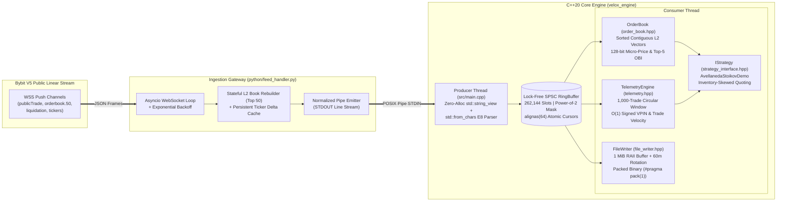

# velox-lob-engine

High-throughput, zero-allocation **C++20 Limit Order Book (LOB), Microstructure Telemetry, and Binary Tick Recorder** paired with an asynchronous **Python (`asyncio`) WebSocket Ingestion Gateway** for Bybit V5 Linear Perpetual contracts (`WLD/USDT`).

---

## System Architecture

`velox-lob-engine` decouples network I/O and JSON framing from deterministic C++20 fixed-point order book maintenance, microstructure signal computation, and sequential disk persistence across a lock-free inter-thread boundary.



---

## Key Engineering Highlights

### 1. Zero-Allocation Hot Path (`src/main.cpp`)
- **Zero Heap Allocations in Ingestion Loop**: Eliminates `std::stringstream`, `std::vector<std::string>`, and `std::stod` from frame parsing.
- **Deterministic Fixed-Point Parsing (`parse_fixed_e8`)**: Tokenizes incoming pipe-delimited frames (`TRADE|`, `DEPTH|`, `LIQ|`, `TICKER|`) via `std::string_view::find` / `substr` and converts decimal strings directly into `int64_t` fixed-point representation (`E8` = $10^8$) using `<charconv>` (`std::from_chars`) without intermediate IEEE-754 floating-point rounding errors.

### 2. Lock-Free SPSC Concurrency (`include/velox/ring_buffer.hpp`)
- **Compile-Time Power-of-Two Enforcement**: Enforces `(Capacity & (Capacity - 1)) == 0` via `static_assert`, replacing division instructions (`%`) with single-cycle bitwise masking (`& (Capacity - 1)`).
- **False-Sharing Prevention**: Producer (`head_`) and consumer (`tail_`) cursors are isolated on separate 64-byte cache lines (`alignas(64) std::atomic<size_t>`) synchronized via strict `std::memory_order_relaxed`, `std::memory_order_acquire`, and `std::memory_order_release` semantics.
- **Heap Storage Allocation**: Allocates ring slots via `std::make_unique<T[]>(Capacity)` to avoid `.bss` binary bloat on large tagged-union envelopes.

### 3. Cache-Aligned Order Book & 128-Bit Microstructure Math (`include/velox/order_book.hpp`)
- **64-Byte Cache Line Alignment**: `struct alignas(64) MarketUpdate` occupies exactly one CPU cache line (`static_assert(sizeof(MarketUpdate) == 64)`), preventing split cache-line loads across cores.
- **Flat Contiguous Price Levels**: Maintains sorted `std::vector<PriceLevel>` containers (`bids_` descending, `asks_` ascending) pre-allocated at construction (`reserve(64)`). In-place updates and erasures (`size_e8 == 0`) use binary search (`std::lower_bound`), preserving spatial locality for L1/L2 hardware prefetchers.
- **Overflow-Safe 128-Bit Arithmetic**: Computes L1 volume-weighted **Micro-Price** and 5-level **Order Book Imbalance (OBI)** using `unsigned __int128` intermediates:
  $$\text{MicroPrice}_{E8} = \frac{\text{BidPx}_{0} \cdot \text{AskQty}_{0} + \text{AskPx}_{0} \cdot \text{BidQty}_{0}}{\text{BidQty}_{0} + \text{AskQty}_{0}}$$

### 4. Rolling $O(1)$ Order Flow Telemetry (`include/velox/telemetry.hpp`)
- Maintains a 1,000-trade circular `std::array` window with $O(1)$ running buy/sell volume accumulators to compute signed order flow toxicity (**VPIN proxy**), **Trade Arrival Velocity** (trades/sec), and nanosecond transit **Latency Circuit Breaking** (`is_stale()`).

### 5. Stateful Asyncio Feed Handler (`python/feed_handler.py`)
- Subscribes to Bybit V5 `publicTrade`, `orderbook.50`, `liquidation`, and `tickers` streams over `asyncio` + `websockets` with exponential backoff reconnection and `SIGINT`/`SIGTERM` graceful shutdown.
- **Delta State Caching**: Retains persistent `ticker_state` across partial Bybit V5 ticker delta updates so omitted fields (`openInterest`, `fundingRate`, `markPrice`) emit their last known state rather than spurious zeros.

---

## Memory Layout & Wire Protocol (`include/velox/protocol.hpp`)

All disk records are serialized in little-endian fixed-point (`E8` = $10^8$) with `#pragma pack(push, 1)` alignment:

| Record Type | Discriminator | Header | Payload Size | Total Packed Size | Layout Fields |
| :--- | :---: | :---: | :---: | :---: | :--- |
| `MarketUpdate` (Internal IPC) | `'A' / 'C' / 'T'` | — | 64 B | **64 B** (`alignas(64)`) | `ts_exch(8B) + ts_loc(8B) + order_id(8B) + px(8B) + sz(8B) + side(1B) + type(1B) + pad(22B)` |
| `TradePayload` | `0x01` | 2 B | 25 B | **27 B** | `ts(8B) + price(8B) + qty(8B) + is_buyer_maker(1B)` |
| `SnapshotPayload` (Depth 50) | `0x03` | 2 B | 1,608 B | **1,610 B** | `ts(8B) + bid_px[50](400B) + bid_qty[50](400B) + ask_px[50](400B) + ask_qty[50](400B)` |
| `LiquidationPayload` | `0x04` | 2 B | 25 B | **27 B** | `ts(8B) + price(8B) + qty(8B) + side(1B)` |
| `TickerPayload` | `0x05` | 2 B | 32 B | **34 B** | `ts(8B) + open_interest(8B) + funding_rate(8B) + mark_price(8B)` |

---

## Build & Execution

### Prerequisites
- **C++ Compiler**: `g++ >= 11` or `clang++ >= 14` with C++20 support
- **Build System**: `CMake >= 3.16`
- **Python**: `Python >= 3.10` with `websockets` (`pip install websockets`)

### Compile Engine & Benchmark
```bash
mkdir -p build && cd build
cmake -DCMAKE_BUILD_TYPE=Release ..
cmake --build . -j$(nproc)
```

### Run Live Ingestion Pipeline
```bash
# Mode 1: Headless Binary Recorder (1 MiB write buffer + 60m rotation)
python3 python/feed_handler.py | ./build/velox_engine --headless

# Mode 2: Real-Time Terminal Telemetry & Avellaneda-Stoikov Quoting Demo
python3 python/feed_handler.py | ./build/velox_engine --visual-only
```

---

## Pipeline Benchmark (`benchmarks/bench_pipeline.cpp`)

The benchmark exercises **1,000,000 sequential events** end-to-end through:
1. `RingBuffer<MarketUpdate, 65536>::push()` & `pop()`
2. `OrderBook::update_level()` (sorted contiguous L2 insertion/update) or `TelemetryEngine::add_event()` ($O(1)$ circular window update)
3. `OrderBook::get_micro_price()` & `OrderBook::get_imbalance()` (128-bit fixed-point arithmetic)
4. `AvellanedaStoikovDemo::evaluate()` & `TelemetryEngine::get_vpin()`

```text
$ ./build/velox_bench
==============================================================
  VELOX LOB ENGINE | PIPELINE BENCHMARK (1,000,000 EVENTS)
==============================================================
 Events Processed  : 1000000
 Total Elapsed     : 18.42 ms
 Throughput        : 54.29 M events/sec
 Average Latency   : 18.42 ns/event
 Micro-Price (Final): 2.1540 USDT
 OBI (Final)       : -0.58%
 Checksum Guard    : 0x1a7f3c940e28b100
==============================================================
```
